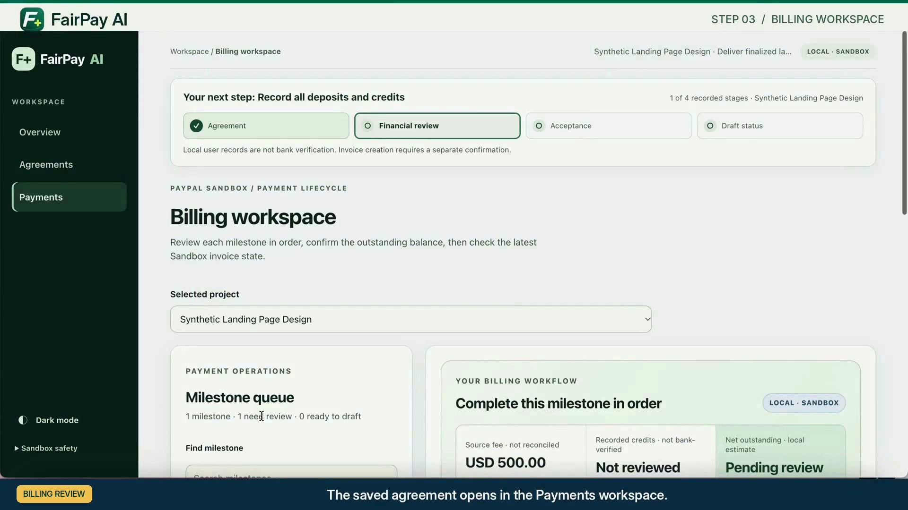

# FairPay AI

**Evidence-led billing for freelancers and small service teams.**

FairPay AI helps users review agreement terms, check billing amounts against the source, and work with PayPal Sandbox invoice drafts under explicit human approval. The AI proposes information. It does **not** authorize billing or verify payments.

**[Watch the 3-minute demo](https://www.youtube.com/watch?v=pivk3KyXpEQ)** · **[Explore the workflow](docs/USER_GUIDE.md)** · **[Install and test](docs/DEVELOPER_GUIDE.md)** · **[Validation and limitations](docs/VALIDATION.md)**

> **Hackathon prototype only.** Local single-user application, synthetic examples, PayPal Sandbox only. **Not production-ready.** Do not use real client data, funds, or live credentials.

## Product preview



*Agreements interface captured from the [product demo](https://www.youtube.com/watch?v=pivk3KyXpEQ). This is a recorded demonstration, not a hosted live app.*

## Product overview

1. **AI-assisted agreement analysis.** Local Ollama with `qwen3:4b-instruct` proposes milestones, fees, deliverables, and source excerpts. Users check the source before accepting suggestions.
2. **Source verification.** An incorrect $50 suggestion is corrected against an agreement that states $500.
3. **Financial review.** Contract fees, manually recorded credits, and outstanding balances remain separate. $500 less a user-recorded $100 credit produces a **calculated $400 balance**. This credit is **not bank verified**.
4. **Human safety gates.** Missing evidence, incomplete review, unresolved acceptance, or an amount mismatch can block invoice drafting.
5. **PayPal Sandbox.** Explicitly authorized draft handling and read-back. The final video separately shows an **existing $400 Sandbox DRAFT**, **not sent or paid**.

These are **separate demonstration scenarios**, not a single completed or bank-verified payment. A fresh clone has **zero saved projects** and no access to the historical private Sandbox invoice.

## Start here

| Goal | Read |
| --- | --- |
| See the finished product demonstration | [Final demo video](https://www.youtube.com/watch?v=pivk3KyXpEQ) |
| Explore the screens and fictional examples | [Product workflow](docs/USER_GUIDE.md) |
| Install the app, enable AI, or inspect source code | [Installation and testing](docs/DEVELOPER_GUIDE.md) |
| Follow a safe synthetic walkthrough | [Demo Guide](FairPay/DEMO_GUIDE.md) |
| Evaluate test evidence and known limitations | [Validation & Limitations](docs/VALIDATION.md) |
| Find more technical and historical documents | [Documentation Index](docs/README.md) |

## Version and release scope

| Identifier | Value | Meaning |
| --- | --- | --- |
| Application build | `1.9.1-dev.8.6-sprint-b` | The current source candidate in `FairPay/package.json` and `FairPay/VERSION.txt` |
| Demo video | V31 · 2:58.67 | The separately edited YouTube presentation, not the application version |
| `appVersion: 1.3.2` | Legacy API compatibility field | Not the current product release number |
| Release status | Local hackathon prototype | Not deployed for real payments |

Versioned test filenames and historical manifests identify prior engineering checkpoints. The `appVersion` API field is retained for compatibility; use `productVersion` for the current application identifier. See [Installation and testing](docs/DEVELOPER_GUIDE.md) for current commands.

## Quick start

Requires **Node.js 22+**. The Node application uses built-in modules and does not require installing npm dependencies.

```bash
git clone https://github.com/tai-tai-12/fairpay-ai.git
cd fairpay-ai/FairPay
npm run setup
npm start
```

Open **http://127.0.0.1:3000**. Choose **Overview → Preview two safe billing decisions**. The previews fill fictional source text only. They do not run AI analysis, save a project, contact PayPal, or record payment.

For actual AI extraction, install and run [Ollama](https://ollama.com/download) locally, then run:

```bash
ollama pull qwen3:4b-instruct
```

Without the running model, extraction is unavailable. PayPal API testing is optional and requires your **own Sandbox** credentials. See the [Developer Guide](docs/DEVELOPER_GUIDE.md).

## Architecture at a glance

```text
Agreement text or document
     ↓
Local AI proposes candidate terms and source excerpts
     ↓
Source verification + deterministic financial rules
     ↓
Human review, acceptance, and authorization
     ↓
PayPal Sandbox invoice DRAFT and read-back
```

- `FairPay/public/` contains the browser interface.
- `FairPay/server.mjs` serves the local app and API routes.
- `FairPay/agreement-evidence.mjs`, `financial-policy.mjs`, and `receivables.mjs` handle the evidence and financial model.
- `FairPay/paypal-adapter.mjs` handles provider integration.
- `FairPay/tests/`, `evaluation/`, `audit/`, and `tools/` contain regression checks, synthetic evaluation cases, audit checks, and setup utilities.

## What a fresh install can reproduce

| Setup | Expected result |
| --- | --- |
| Node.js only | Browser UI, empty project list, and read-only synthetic sample previews |
| Node.js + running Ollama model | Real AI candidate extraction for sample agreement text, followed by source review |
| Plus your own PayPal Sandbox credentials | Optional authorized Sandbox testing with *new synthetic data*; not the private historical invoice |

For a step-by-step walkthrough, use the [product workflow](docs/USER_GUIDE.md). This repository cannot recreate the video's existing $400 draft because its private invoice reference and local records are intentionally excluded.

## Evidence and limitations

The focused QA suite completed **161 passing checks** in the documented local run, including current regressions, scoring checks, isolated HTTP checks, and frozen adversarial checks. This does **not** mean the broader historical suite is fully passing or that the application is production-ready. Reproduce the checks and review their limits in [Validation and limitations](docs/VALIDATION.md).

The video depicts a separate existing Sandbox DRAFT read-back. Earlier isolated engineering QA **did not independently access the private Sandbox invoice**, so its remote verification result remains recorded as **incomplete**. The synthetic credit is not a bank-confirmed deposit. See [Validation & Limitations](docs/VALIDATION.md) and [Security & Privacy](FairPay/SECURITY_AND_PRIVACY.md).

The service binds to `127.0.0.1` and persists local records. It lacks production authentication, buyer identity verification, independent bank settlement verification, and secure hosted deployment. Never expose the app to the public internet.

## License

[MIT License](LICENSE). Copyright © 2026 FairPay AI Project Contributors.
