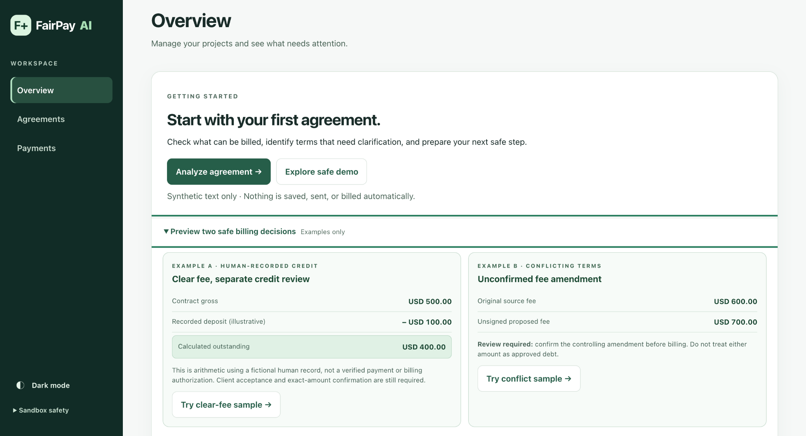
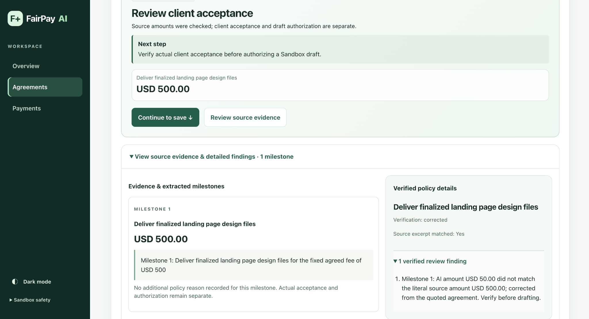
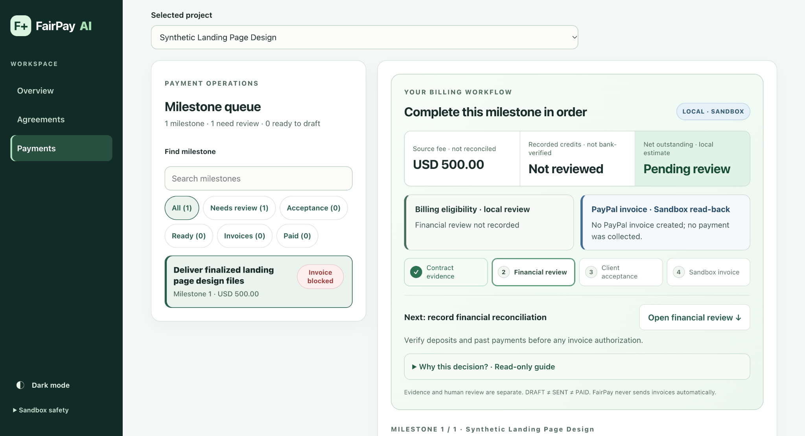

# FairPay AI — Product Tour

Three screenshots from a local, single-user **synthetic-data** demonstration on November 4, 2026. These are real FairPay application screens, not a hosted service or a paid transaction. Start with the [project overview](../README.md), or watch the [V31 demonstration video](https://www.youtube.com/watch?v=pivk3KyXpEQ).

## 1. Overview — see two different billing decisions

The first read-only sample illustrates **USD 500 gross − USD 100 fictional, human-recorded credit = USD 400 calculated outstanding**. The other shows an original USD 600 fee and a proposed unsigned USD 700 fee that requires clarification. **Neither preview records a credit, performs AI analysis, saves a project, or contacts PayPal.**

## 2. Agreements — compare an AI suggestion with its source

In this separately recorded local analysis, the AI initially proposed **USD 50**, but the quoted agreement explicitly said **USD 500**. FairPay identified the discrepancy and displayed a corrected, source-supported milestone. This is an observed synthetic example, **not a general model-accuracy claim**. Source matching is **not** evidence of client acceptance or permission to create an invoice.

## 3. Payments — see why billing is blocked

For this fictional project, the Payments workspace displays the USD 500 source fee while showing **credits not reviewed**, **net outstanding pending review**, and **Invoice blocked**. The next action is to record financial reconciliation. **No PayPal invoice exists in this screenshot**. A source-supported fee is not verified debt, a credit is not bank verification, and the application never treats a DRAFT as paid.

## What the separate $400 Sandbox example means

The [V31 video](https://www.youtube.com/watch?v=pivk3KyXpEQ) also shows a **different historical synthetic project** with an existing **USD 400 PayPal Sandbox DRAFT** and a recorded read-back. Its human-entered USD 100 credit was **not independently bank-verified**. The DRAFT was neither sent nor paid. The private historical invoice reference, authorization state and merchant credentials are **not included in the public repository**. A fresh clone cannot reproduce that exact invoice; it can reproduce the public source, local previews and its own deliberately authorized tests with separate Sandbox credentials.

See [How to explore the app](USER_GUIDE.md), [Installation and Testing](DEVELOPER_GUIDE.md) and [Validation and Limitations](VALIDATION.md) for reproducible steps and evidence boundaries.
